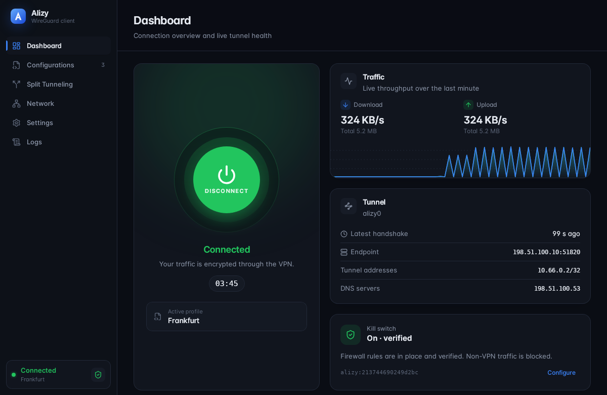

<p align="center"><a href="README.md">English</a> · <b>فارسی</b></p>

<p align="center">
  
</p>

<h1 align="center">Alizy</h1>

<div dir="rtl">

<p align="center">
  <b>کلاینت VPN برای لینوکس با کیل‌سوییچی که در خود کرنل اجرا می‌شود.</b><br>
  تونل WireGuard و SSH · حالت تونل یا پراکسی · کیل‌سوییچ nftables · جلوگیری از نشت DNS · تفکیک ترافیک · اشتراک‌گذاری VPN
</p>

<p align="center">
  <a href="https://github.com/jonios/alizy/releases/latest"><b>دانلود</b></a> ·
  <a href="docs/INSTALLATION.md">راهنمای نصب (انگلیسی)</a> ·
  <a href="#امکانات">امکانات</a> ·
  <a href="docs/TROUBLESHOOTING.md">رفع مشکل (انگلیسی)</a> ·
  <a href="SECURITY.md">امنیت (انگلیسی)</a>
</p>

<p align="center">
  
</p>

الیزی ترافیک شما را حتی وقتی اوضاع خراب می‌شود داخل VPN نگه می‌دارد. کیل‌سوییچ آن
مجموعه‌ای از قوانین nftables است که یک سرویس کوچک سیستمی مالک آن است، **نه** قابلیتی از
پنجره‌ای که روی آن کلیک می‌کنید. این قوانین وقتی برنامه بسته می‌شود یا از کار می‌افتد،
وقتی سرویس دوباره راه‌اندازی یا به‌روز می‌شود، و از همان ابتدای بوت پیش از بالا آمدن شبکه
در کرنل باقی می‌مانند. الیزی هر دو ثانیه آن‌ها را با وضعیت کرنل مقایسه می‌کند و اگر چیزی
آن‌ها را حذف کرده باشد، دوباره برمی‌گرداند.

برنامه یک **AppImage** قابل‌حمل است که با کاربر خودتان اجرا می‌شود. بخش دارای دسترسی ریشه
`alizyd` است که یک بار با یک نصب‌کننده‌ی کوچک و خوانا نصب می‌شود.

رابط کاربری برنامه به زبان‌های **انگلیسی** (پیش‌فرض) و **فارسی** (راست‌به‌چپ) در دسترس است:
*Settings ← Language*.

## امکانات

| | |
|---|---|
| **WireGuard** | WireGuard کرنل؛ الیزی پروتکل را دوباره پیاده‌سازی نمی‌کند. فایل‌های `.conf` را تکی، گروهی، از یک پوشه، با کشیدن و رها کردن یا با چسباندن وارد کنید. اسکریپت‌های `PostUp`/`PreDown` حذف می‌شوند و هرگز اجرا نمی‌شوند. |
| **کیل‌سوییچ** | یک جدول nftables (`inet alizy`) که به‌صورت اتمی جایگزین می‌شود، با کرنل تطبیق داده می‌شود و پس از خرابی و راه‌اندازی دوباره بازمی‌گردد. IPv4 و IPv6 را جداگانه خاموش کنید. |
| **جلوگیری از نشت DNS** | DNS (پورت 53 روی UDP و TCP، و 853 روی TCP) بیرون از تونل مسدود می‌شود. با systemd-resolved، resolvconf یا یک `/etc/resolv.conf` ساده کار می‌کند. |
| **تفکیک ترافیک** | پیش‌فرض همه‌چیز از VPN است؛ بازه‌های IP یا دامنه‌های انتخابی را مستقیم بفرستید. با ترجمه‌ی نام آگاه از TTL، پشتیبانی CNAME، هشدار CDNهای مشترک و آزمون مسیریابی که وضعیت واقعی کرنل را می‌خواند. |
| **تونل SSH** | سرور WireGuard ندارید؟ کل سیستم را از طریق SSH تونل کنید. کلید میزبان سنجاق می‌شود (اعتماد در اولین استفاده)، `ssh` بدون دسترسی ریشه اجرا می‌شود و UDP مسدود است تا چیزی از کنار تونلِ فقط-TCP نشت نکند. |
| **حالت تونل یا پراکسی** | در *حالت تونل* همه‌ی ترافیک رایانه از VPN عبور می‌کند. در *حالت پراکسی* سیستم دست‌نخورده می‌ماند و یک پراکسی محلی SOCKS5/HTTP روی `127.0.0.1` فعال می‌شود: فقط برنامه‌هایی که روی آن تنظیم شده‌اند از VPN استفاده می‌کنند و وقتی VPN قطع است، پراکسی به‌جای اتصال مستقیم، اتصال‌ها را رد می‌کند. |
| **اشتراک‌گذاری VPN** | VPN خود را با تلویزیون، کنسول بازی یا گوشی در Wi-Fi به اشتراک بگذارید: پراکسی HTTP و SOCKS5 (SOCKS5 همراه با UDP)، در صورت تمایل با نام کاربری و گذرواژه. |
| **پروفایل‌ها** | علاقه‌مندی‌ها، دسته‌بندی، ویرایش، رونوشت، خروجی، پشتیبان‌گیری و بازیابی. کلیدهای خصوصی در کلیدساز (keyring) دسکتاپ نگهداری می‌شوند، هرگز در پایگاه داده. |
| **برنامه‌ی دسکتاپ** | رابط انگلیسی و فارسی، آیکون سینی سیستم، اعلان‌ها، پوسته‌ی روشن و تیره، اجرا هنگام ورود، اتصال خودکار و اتصال دوباره پس از به‌روزرسانی. گزارش رویدادها و تاریخچه‌ی اتصال. |

## نصب

الیزی روی **لینوکس x86_64 با systemd و glibc نسخه‌ی 2.35 یا بالاتر** اجرا می‌شود: Ubuntu 22.04
به بعد، Debian 12 به بعد، Fedora 36 به بعد، Arch، Omarchy، Linux Mint 21 به بعد و توزیع‌های دیگر.

1. از [آخرین نسخه](https://github.com/jonios/alizy/releases/latest) فایل‌های
   `Alizy-x86_64.AppImage`، `alizy-installer-x86_64` و `SHA256SUMS` را در یک پوشه دانلود کنید.
2. در یک ترمینال در همان پوشه:

   ```bash
   sha256sum -c SHA256SUMS
   ```

   ```bash
   chmod +x alizy-installer-x86_64 Alizy-x86_64.AppImage && ./alizy-installer-x86_64
   ```

   نصب‌کننده گذرواژه‌ی شما را می‌پرسد، سیستم را بررسی می‌کند و پیشنهاد می‌دهد هر بسته‌ی
   لازمی را که نصب نیست (`wireguard-tools`، `nftables`، `iproute2`، `polkit`) با مدیر بسته‌ی
   شما نصب کند. برنامه‌اش را نشان می‌دهد و منتظر تأیید شما می‌ماند. سپس سرویس را نصب و اجرا
   می‌کند (با کیل‌سوییچ **خاموش**)، شما را به گروه `alizy` اضافه می‌کند و **Alizy** را به منوی
   برنامه‌ها می‌افزاید.
3. **از حساب کاربری خارج و دوباره وارد شوید** تا نشست شما عضو گروه `alizy` شود. با
   `id -nG | grep -w alizy` بررسی کنید؛ اگر نبود، یک بار رایانه را دوباره راه‌اندازی کنید.
4. **Alizy** را از منو باز کنید.

**چرا دو فایل؟** AppImage فقط خود برنامه است. کیل‌سوییچ، تونل‌ها و DNS به یک سرویس با دسترسی
ریشه نیاز دارند که هنگام بوت اجرا شود. AppImage نمی‌تواند چنین سرویسی نصب کند و نباید بتواند
فقط با بستن یک پنجره فایروال شما را خاموش کند.

جزئیات، نکته‌های هر توزیع و بسته‌های اختیاری: **[docs/INSTALLATION.md](docs/INSTALLATION.md)** (انگلیسی).

### نیازمندی‌ها

| | لازم | اختیاری |
|---|---|---|
| **سرویس سیستمی** | systemd، WireGuard کرنل (لینوکس 5.6 به بعد)، `wireguard-tools`، `nftables`، `iproute2`، `polkit` | `openssh` و `badvpn` (پروفایل‌های SSH)؛ `openresolv`/`resolvconf` (فقط اگر از resolvconf استفاده می‌کنید) |
| **برنامه** | چیزی لازم نیست: کتابخانه‌های گرافیکی داخل AppImage هستند؛ FUSE 2 برای سوار کردن آن (یا `--appimage-extract-and-run`) | `libayatana-appindicator` و یک میزبان StatusNotifier (آیکون سینی)؛ یک کلیدساز Secret Service (GNOME Keyring، KWallet، KeePassXC) |

## گام‌های نخست

1. **یک پروفایل وارد کنید:** *Configurations ← Import* (یک فایل `.conf` وایرگارد، چند فایل،
   یک پوشه، کشیدن و رها کردن یا چسباندن)، یا *New SSH profile*.
2. **وصل شوید:** پروفایل را در داشبورد انتخاب کنید و دکمه‌ی بزرگ را بزنید.
3. **کیل‌سوییچ را روشن کنید** در *Network*. از آن به بعد هیچ چیزی بیرون از VPN از رایانه‌ی شما
   خارج نمی‌شود: نه وقتی VPN قطع می‌شود، نه وقتی برنامه از کار می‌افتد، نه پس از راه‌اندازی دوباره.

بستن پنجره الیزی را به سینی سیستم می‌برد و **Quit** فقط برنامه را می‌بندد. هیچ‌کدام VPN را قطع
نمی‌کنند و کیل‌سوییچ را خاموش نمی‌کنند؛ این‌ها متعلق به سرویس هستند.

| کار | VPN و کیل‌سوییچ |
|---|---|
| بستن پنجره / خروج از برنامه | بدون تغییر |
| خاموش کردن کیل‌سوییچ (Network) | قوانین حذف می‌شوند و ترافیک عادی جریان می‌یابد |
| `systemctl stop alizyd` | قوانین کیل‌سوییچ در کرنل **باقی می‌مانند** (حالت بسته در خطا) |
| `sudo alizyd --remove-firewall` | همه‌ی قوانین الیزی حذف می‌شوند |

## کیل‌سوییچ چگونه کار می‌کند

- وقتی کیل‌سوییچ **روشن و متصل** است، فقط رابط تونل، نشانی و پورت سرور VPN (بسته‌های
  علامت‌خورده از سوکت WireGuard)، loopback، DHCP و در صورت تمایل شبکه‌ی محلی شما اجازه‌ی عبور
  دارند. بقیه دور ریخته می‌شود.
- وقتی **روشن و متصل نیست** (*Protected*)، فقط loopback، DHCP، کشف همسایه‌ی IPv6 و در صورت
  تمایل شبکه‌ی محلی.
- قوانین در یک جدول nftables به نام `inet alizy` هستند که به‌صورت اتمی جایگزین می‌شود، پس هیچ
  لحظه‌ای بدون قانون مسدودسازی وجود ندارد، حتی هنگام تعویض پروفایل. الیزی هرگز کل مجموعه‌ی
  قوانین را پاک نمی‌کند و به ufw، firewalld یا جدول‌های دیگر دست نمی‌زند.
- پس از هر تغییر، الیزی جدول را از کرنل می‌خواند و فقط اگر دقیقاً مطابق باشد آن را *تأییدشده*
  گزارش می‌کند؛ هر ۲ ثانیه دوباره بررسی می‌کند و دست‌کاری را ترمیم می‌کند.
- سرویس پیش از `network-pre.target` اجرا می‌شود و فقط پس از برقراری محافظت به systemd اعلام
  آمادگی می‌کند؛ پس پس از راه‌اندازی دوباره، شبکه از همان ابتدا محافظت‌شده بالا می‌آید.

مدل امنیتی و محدودیت‌ها: [SECURITY.md](SECURITY.md)، [ROUTING_SECURITY.md](ROUTING_SECURITY.md) (انگلیسی).

## حالت تونل و حالت پراکسی

*Network ← Connection mode* شیوه‌ی استفاده از VPN را تعیین می‌کند:

| | حالت تونل (پیش‌فرض) | حالت پراکسی |
|---|---|---|
| چه چیزی از VPN استفاده می‌کند | همه‌چیز در رایانه، حتی برنامه‌هایی که از پراکسی پشتیبانی نمی‌کنند | فقط برنامه‌هایی که روی `127.0.0.1:10808` (SOCKS5) یا `127.0.0.1:10809` (HTTP) تنظیم شده‌اند |
| مسیرها و DNS سیستم | هنگام اتصال تغییر می‌کنند | دست‌نخورده می‌مانند |
| کیل‌سوییچ | در دسترس | استفاده نمی‌شود (تنظیم شما با برگشت به حالت تونل بازمی‌گردد) |
| قطع شدن VPN | کیل‌سوییچ ترافیک مستقیم را مسدود می‌کند | پراکسی اتصال‌ها را رد می‌کند؛ برنامه‌های دیگر از اتصال عادی استفاده می‌کنند |

تغییر حالت، VPN را دوباره وصل می‌کند و پیش از آن مسیرها، قوانین و DNS حالت قبلی را پاک‌سازی
می‌کند. در حالت پراکسی، ترافیک پراکسی برای WireGuard علامت‌گذاری می‌شود تا فقط جدول مسیریابی
تونل آن را حمل کند، و فایروال بسته‌های علامت‌خورده را روی هر رابط دیگری رد می‌کند. در SSH، پراکسی
از طریق `ssh -D` کار می‌کند و نام‌ها روی سرور ترجمه می‌شوند.

## اشتراک‌گذاری VPN

*Network ← Share VPN with other devices* یک پراکسی HTTP (پورت 8080) و یک پراکسی SOCKS5
(پورت 1080) روی رایانه‌ی شما راه‌اندازی می‌کند. تنظیم پراکسی تلویزیون یا گوشی را روی نشانی‌ای
که برنامه نشان می‌دهد بگذارید تا آن دستگاه از VPN شما استفاده کند. SOCKS5 در صورت امکان UDP را
هم منتقل می‌کند (UDP ASSOCIATE) تا بازی‌ها و تماس‌ها کار کنند؛ تونل‌های SSH فقط TCP هستند.
به‌طور پیش‌فرض **گذرواژه‌ای در کار نیست**؛ گزینه‌ی *Require a username and password* را روشن
کنید تا دستگاه‌ها مجبور به ورود باشند. سرویس فقط هش نمک‌دار گذرواژه را نگه می‌دارد؛ توجه کنید
که اطلاعات ورود پراکسی HTTP بدون رمزنگاری از شبکه‌ی محلی عبور می‌کند. جزئیات:
[LAN_PROXY.md](LAN_PROXY.md) (انگلیسی).

## تفکیک ترافیک

همه‌چیز از VPN عبور می‌کند مگر این‌که یک قانون *Direct* چیز دیگری بگوید. قانون‌ها می‌توانند
نشانی یا بازه‌ی IP (`192.0.2.0/24`)، دامنه‌ی دقیق (`bank.example.com`) یا کل یک دامنه
(`*.example.org`) باشند. دقیق‌ترین قانون برنده است و قانون *VPN* بر قانون *Direct* هم‌وزن
مقدم است. DNS هرگز از کنار تونل عبور نمی‌کند. قانون‌ها را به‌صورت TXT، CSV یا JSON وارد و
خارج کنید؛ **آزمون مسیریابی** نشان می‌دهد یک مقصد واقعاً از کجا می‌رود. قانون‌های مبتنی بر
برنامه هنوز پیاده‌سازی نشده‌اند. تفکیک ترافیک فقط در حالت تونل اعمال می‌شود.

## تونل SSH

پروفایل SSH هر سرور SSH را که بتوانید وارد آن شوید به یک VPN سراسری تبدیل می‌کند. الیزی
`ssh -D` و `badvpn-tun2socks` را با کاربر بدون دسترسی `alizy-ssh` اجرا می‌کند. اثر انگشت کلید
سرور را یک بار تأیید می‌کنید و پس از آن سنجاق می‌شود. گذرواژه از طریق یک سوکت یک‌بارمصرف و
محافظت‌شده با توکن به `ssh` می‌رسد، هرگز از خط فرمان یا متغیرهای محیطی. فقط TCP تونل می‌شود،
پس UDP مسدود است و DNS از طریق TCP و داخل تونل عبور می‌کند. به `openssh` و `badvpn` نیاز دارد.

## به‌روزرسانی

AppImage و نصب‌کننده‌ی نسخه‌ی جدید را دانلود کنید و دوباره نصب‌کننده را اجرا کنید. پروفایل‌ها،
کلیدها و تنظیمات حفظ می‌شوند و سرویس با نسخه‌ی جدید دوباره راه‌اندازی می‌شود. با کیل‌سوییچ روشن،
در این مدت چیزی نشت نمی‌کند و برنامه خودش دوباره وصل می‌شود. اگر سرویس جدید اجرا نشود،
نصب‌کننده نسخه‌ی قبلی را بازمی‌گرداند. بیشتر: [docs/UPDATING.md](docs/UPDATING.md) (انگلیسی).

## حذف

```bash
sudo /usr/local/lib/alizy/alizy-installer uninstall
```

سرویس و **فقط** جدول فایروال، قوانین مسیریابی و رابط الیزی را حذف می‌کند و DNS را بازمی‌گرداند.
پیش از آن توضیح می‌دهد که VPN و کیل‌سوییچ متوقف می‌شوند و تأیید شما را می‌خواهد. `remove-app`
فایل AppImage و ورودی منو را حذف می‌کند. پروفایل‌ها، کلیدها و تنظیمات شما هرگز حذف نمی‌شوند.
بیشتر: [docs/UNINSTALLATION.md](docs/UNINSTALLATION.md) (انگلیسی).

## رفع مشکل

`/usr/local/lib/alizy/alizy-installer status` و *Settings ← System Check* به بیشتر پرسش‌ها پاسخ
می‌دهند. موارد رایج (در دسترس نبودن سرویس، مسدود شدن شبکه توسط کیل‌سوییچ، DNS، AppImage/FUSE،
آیکون سینی، کلیدساز) در **[docs/TROUBLESHOOTING.md](docs/TROUBLESHOOTING.md)** (انگلیسی) آمده‌اند.

## امنیت

- **بسته در خطا:** اگر فایروال تأیید نشود، اتصال متوقف می‌شود. خرابی‌ها و راه‌اندازی‌های دوباره
  قوانین را سر جایشان نگه می‌دارند.
- **بدون شل:** هر برنامه‌ی خارجی با فهرست آرگومان، محیط پاک‌شده و `PATH` ثابت اجرا می‌شود.
  پیکربندی‌های واردشده تجزیه و دوباره ساخته می‌شوند و اسکریپت‌ها حذف می‌شوند.
- **کمترین دسترسی:** برنامه هرگز با دسترسی ریشه اجرا نمی‌شود. سوکت سرویس `0660 root:alizy` است
  و تغییرها برای هر درخواست با polkit مجاز می‌شوند. `ssh` و `tun2socks` با `alizy-ssh` اجرا
  می‌شوند.
- **کلیدها:** در حافظه صفر می‌شوند، در گزارش‌ها پنهان می‌شوند و هرگز در SQLite ذخیره نمی‌شوند.
- **انتشارها:** از روی یک تگ در GitHub Actions ساخته می‌شوند و همراه `SHA256SUMS` منتشر می‌شوند.

آسیب‌پذیری‌ها را به‌صورت خصوصی گزارش کنید ([SECURITY.md](SECURITY.md))، نه در issueهای عمومی.

## معماری و ساخت از سورس

معماری: [ARCHITECTURE.md](ARCHITECTURE.md)؛ چگونگی افزودن پروتکل‌ها و طرح sing-box و
اشتراک‌ها: [docs/MULTI_PROTOCOL.md](docs/MULTI_PROTOCOL.md) (انگلیسی). دستورهای ساخت و آزمون
در [README.md](README.md#building-from-source) آمده‌اند.

## مجوز

[GPL-3.0-or-later](LICENSE)

</div>
