<p align="center">
  
</p>

<h1 align="center">Alizy</h1>

<p align="center">
  <b>A Linux VPN client with a kill switch that lives in the kernel.</b><br>
  WireGuard and SSH tunnels · nftables kill switch · DNS leak protection · split tunnelling · LAN proxy
</p>

<p align="center">
  <a href="https://github.com/jonios/alizy/releases/latest"><b>Download</b></a> ·
  <a href="docs/INSTALLATION.md">Install guide</a> ·
  <a href="#features">Features</a> ·
  <a href="docs/TROUBLESHOOTING.md">Troubleshooting</a> ·
  <a href="SECURITY.md">Security</a>
</p>

<p align="center">
  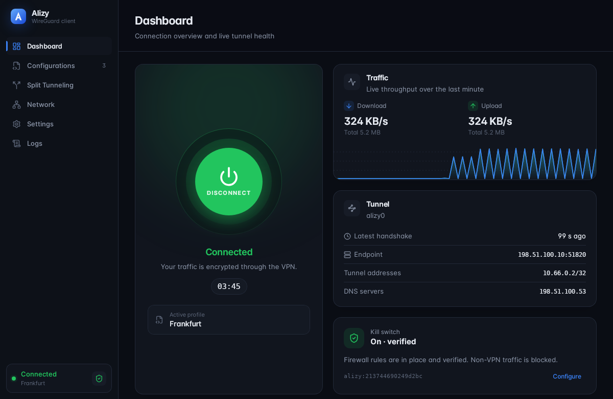
</p>

Alizy keeps your traffic inside the VPN even when things go wrong. Its kill switch is
a set of nftables rules owned by a small system service, **not** a feature of the
window you click on. The rules stay in the kernel when the app is closed or crashes,
when the service restarts or is updated, and from early boot before the network comes
up. Alizy checks them against the kernel every two seconds and puts them back if
anything removes them.

The app is a portable **AppImage** that runs as your user. The privileged part is
`alizyd`, installed once by a small, readable installer.

## Features

| | |
|---|---|
| **WireGuard** | Kernel WireGuard: Alizy doesn't reimplement the protocol. Import `.conf` files one at a time, in bulk, from a folder, by drag-and-drop or by pasting. `PostUp`/`PreDown` scripts are removed and never run. |
| **Kill switch** | One nftables table (`inet alizy`), replaced atomically, verified against the kernel, restored after crashes and reboots. Turn IPv4 and IPv6 off independently. |
| **DNS leak protection** | DNS (53/udp+tcp, 853/tcp) is blocked outside the tunnel. Works with systemd-resolved, resolvconf or a plain `/etc/resolv.conf`. |
| **Split tunnelling** | VPN by default; send chosen IP ranges or domains directly. A TTL-aware resolver, CNAME support, shared-CDN warnings, and a routing test that reads the kernel's real state. |
| **SSH tunnels** | No WireGuard server? Tunnel the whole system over SSH. Host keys are pinned (trust on first use), `ssh` runs unprivileged, UDP is blocked so nothing leaks around a TCP-only tunnel. |
| **LAN proxy** | Share your VPN with a TV, console or phone on your Wi-Fi: HTTP and SOCKS5 proxies whose traffic goes through the tunnel and the kill switch. |
| **Profiles** | Favourites, categories, edit, duplicate, export, backup and restore. Private keys live in your desktop keyring, never in the database. |
| **Desktop app** | Tray icon, notifications, light and dark themes, launch at login, auto-connect, and reconnect after updates. Logs and connection history. |

## Screenshots

Real screenshots of the release AppImage, taken against a real `alizyd`, nftables and
WireGuard in an isolated test network. The profiles and addresses are demo values from
the documentation ranges.

| | |
|---|---|
| 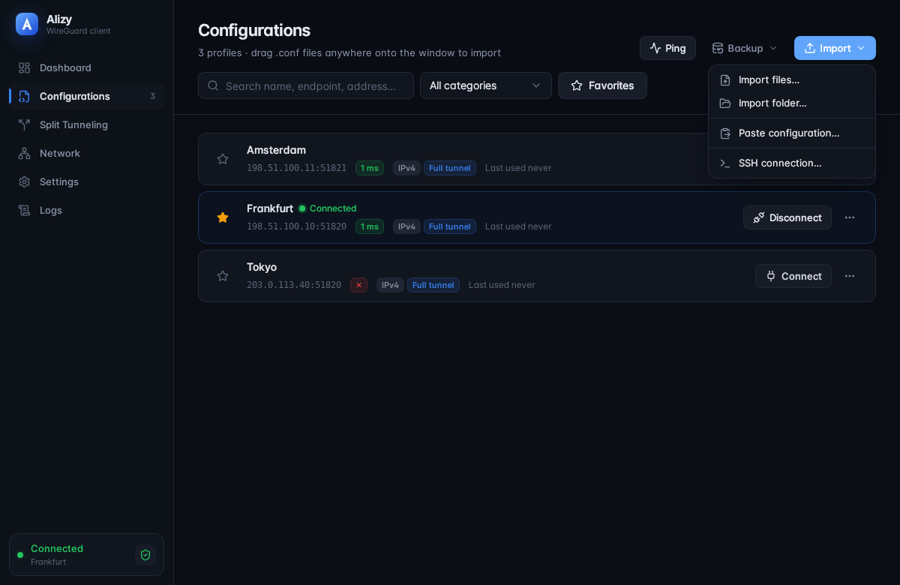<br><sub>**Profiles**: ping, favourites, import from files, folders, paste or SSH</sub> | 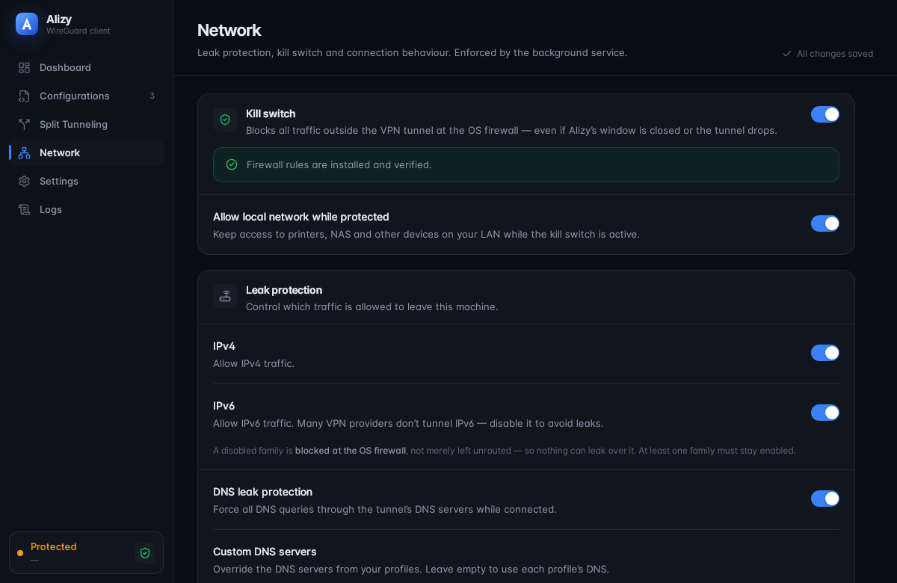<br><sub>**Kill switch** on: rules installed and verified against the kernel</sub> |
| 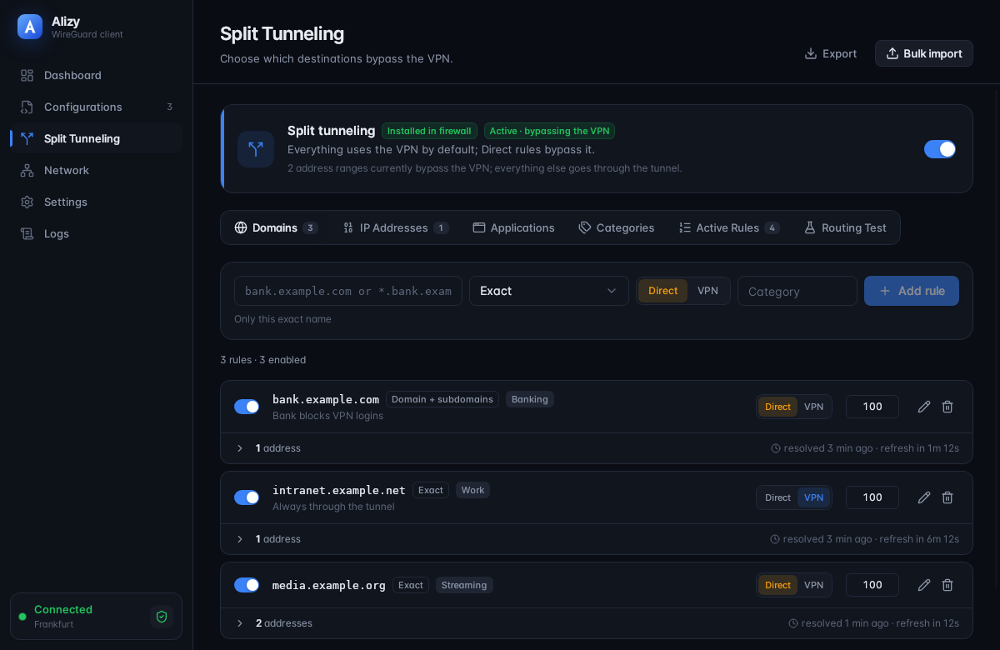<br><sub>**Split tunnelling**: domain rules with live resolution and TTLs</sub> | 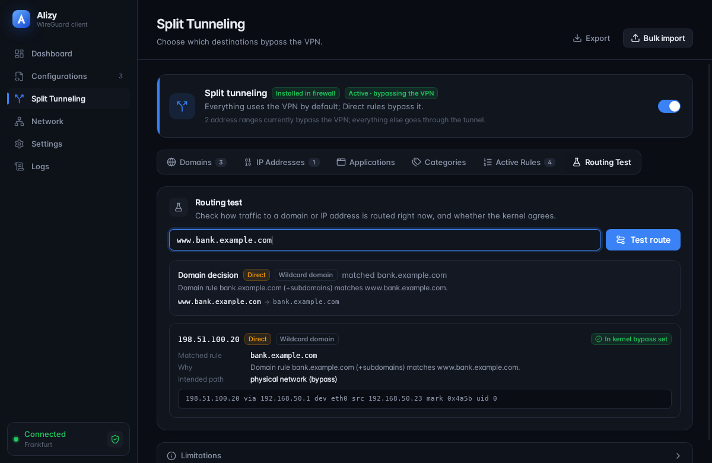<br><sub>**Routing test**: follows CNAMEs and checks the kernel's real route</sub> |
| 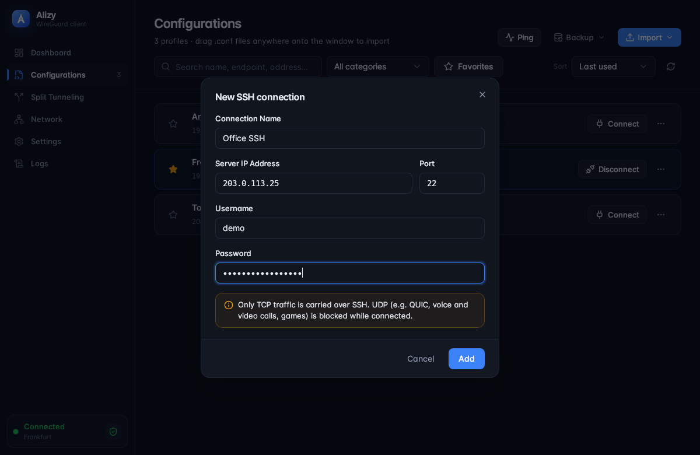<br><sub>**SSH tunnel** profile: a whole-system VPN over SSH</sub> | 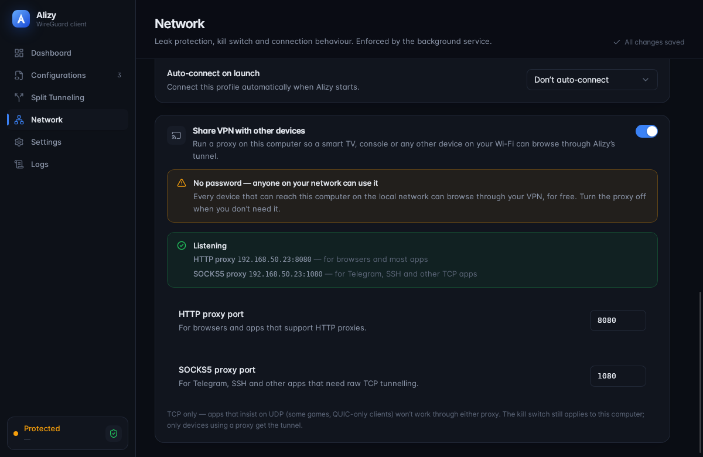<br><sub>**LAN proxy**: share the VPN with a TV or phone</sub> |
| 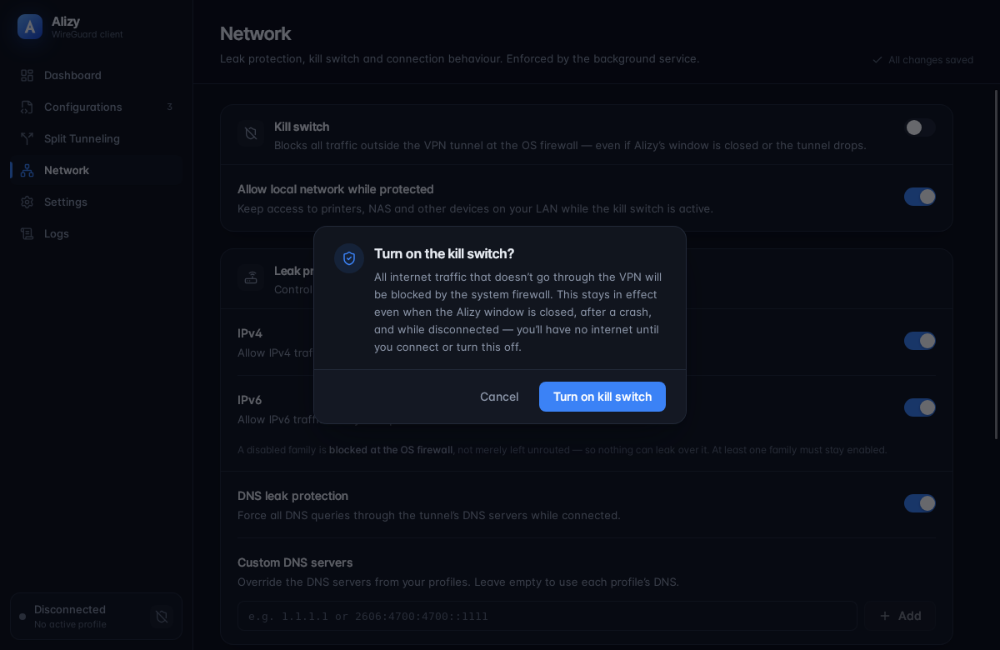<br><sub>Clear confirmation before anything blocks your network</sub> | 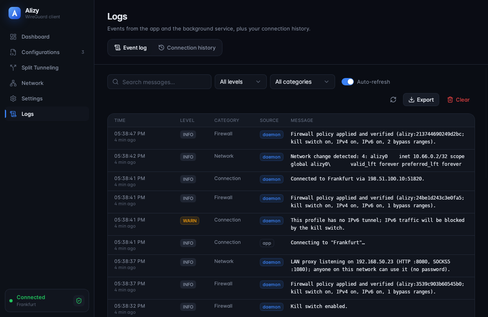<br><sub>**Logs** from the app and the service</sub> |
| 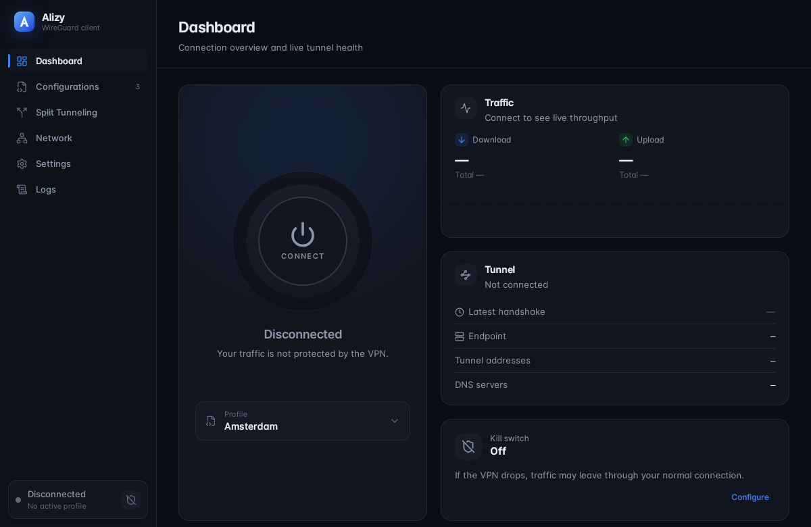<br><sub>Disconnected, kill switch off</sub> | 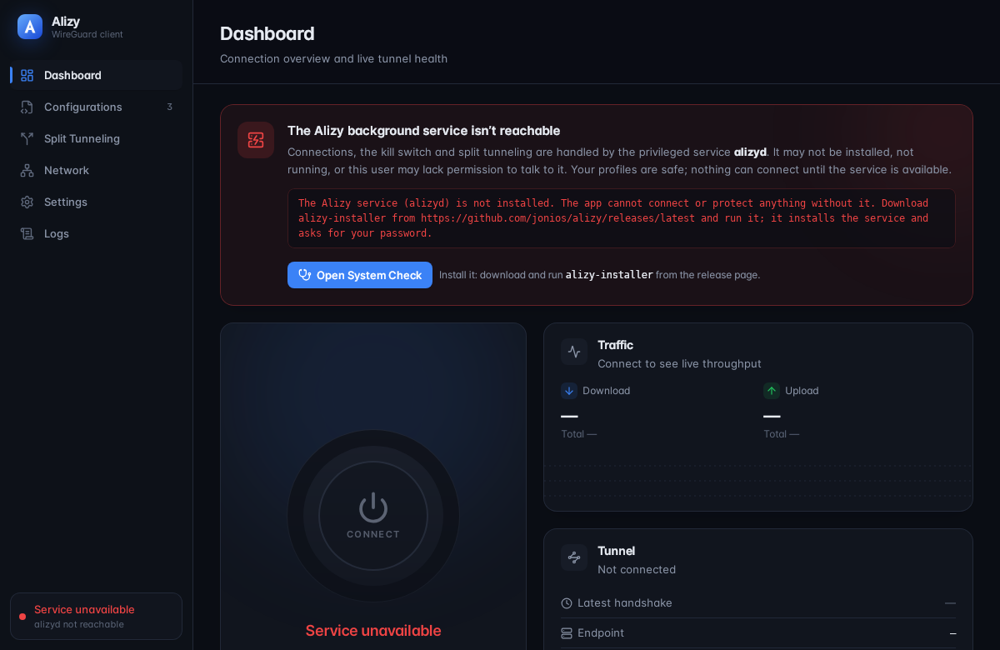<br><sub>Without the service, the app tells you how to install it</sub> |
| 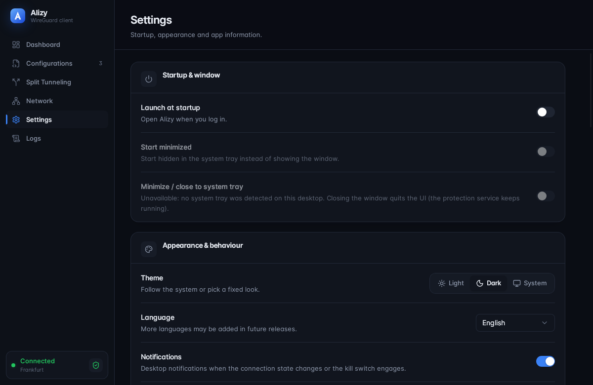<br><sub>**Settings** (the test display has no system tray, so tray options show as unavailable)</sub> | |

## Install

Alizy runs on **x86_64 Linux with systemd and glibc 2.35+**: Ubuntu 22.04+, Debian 12+,
Fedora 36+, Arch, Omarchy, Linux Mint 21+ and others.

1. From the [latest release](https://github.com/jonios/alizy/releases/latest) download
   `Alizy-x86_64.AppImage`, `alizy-installer-x86_64` and `SHA256SUMS` into one folder.
2. In a terminal in that folder:

   ```bash
   sha256sum -c SHA256SUMS
   ```

   ```bash
   chmod +x alizy-installer-x86_64 Alizy-x86_64.AppImage && ./alizy-installer-x86_64
   ```

   The installer asks for your password, checks your system and offers to install
   anything missing (`wireguard-tools`, `nftables`, `iproute2`, `polkit`) with your
   package manager. It shows its plan and waits for your OK. Then it installs and starts
   the service (kill switch **off**), adds you to the `alizy` group and puts **Alizy** in
   your application menu.
3. **Log out and back in** so your session joins the `alizy` group. Check with
   `id -nG | grep -w alizy`; if it's missing, reboot once.
4. Open **Alizy** from the menu.

**Why two files?** The AppImage is only the app. The kill switch, tunnels and DNS need
a root service that starts at boot. An AppImage can't install one, and it shouldn't be
able to switch your firewall off just by closing a window.

Details, per-distribution notes and optional packages: **[docs/INSTALLATION.md](docs/INSTALLATION.md)**.

### Supported distributions

| | Status |
|---|---|
| Arch Linux, Omarchy | **Tested**: installer lifecycle and AppImage (container), real Omarchy machine |
| Ubuntu 22.04, 24.04 | **Tested**: installer lifecycle and AppImage (containers) |
| Debian 12 | **Tested**: installer lifecycle and AppImage (container) |
| Fedora | **Tested** (Fedora 45): installer lifecycle and AppImage (container) |
| Linux Mint, Pop!_OS, Manjaro, EndeavourOS, openSUSE Tumbleweed | expected to work, not tested |
| Without systemd, glibc < 2.35, ARM, Windows, macOS | not supported |

What exactly was tested: [docs/TESTING.md](docs/TESTING.md).

### Requirements

| | Required | Optional |
|---|---|---|
| **System service** | systemd, kernel WireGuard (Linux 5.6+), `wireguard-tools`, `nftables`, `iproute2`, `polkit` | `openssh` + `badvpn` (SSH profiles); `openresolv`/`resolvconf` (only if you use resolvconf) |
| **App** | nothing: GUI libraries are inside the AppImage; FUSE 2 to mount it (or `--appimage-extract-and-run`) | `libayatana-appindicator` + a StatusNotifier host (tray icon); a Secret Service keyring (GNOME Keyring, KWallet, KeePassXC) |

## First steps

1. **Import a profile:** *Configurations → Import* (a WireGuard `.conf` file, several
   files, a folder, drag-and-drop or paste), or *New SSH profile*.
2. **Connect:** pick the profile on the dashboard and press the big button.
3. **Turn on the kill switch** in *Network Settings*. From then on nothing leaves your
   computer outside the VPN: not when the VPN drops, not when the app crashes, not after
   a reboot.

Closing the window hides Alizy to the tray, and **Quit** closes only the app. Neither
disconnects the VPN nor turns off the kill switch: those belong to the service.

| Action | VPN and kill switch |
|---|---|
| Close window / Quit app | unchanged |
| Kill switch off (Network Settings) | rules removed, traffic flows normally |
| `systemctl stop alizyd` | kill-switch rules **stay** in the kernel (fail closed) |
| `sudo alizyd --remove-firewall` | all Alizy rules removed |

## How the kill switch works

- With the kill switch **on and connected**, only the tunnel interface, the VPN server's
  address and port (marked packets from the WireGuard socket), loopback, DHCP and,
  optionally, your LAN may pass. Everything else is dropped.
- With it **on and not connected** (*Protected*), only loopback, DHCP, IPv6 neighbour
  discovery and, optionally, your LAN.
- Rules live in one nftables table, `inet alizy`, which is replaced atomically, so there is never
  a moment without the drop rule, not even while switching profiles. Alizy never flushes
  the ruleset and never touches ufw, firewalld or other tables. A drop in its table is
  final, whatever other tables accept.
- After every change Alizy reads the table back from the kernel and reports *verified*
  only if it matches exactly; it re-checks every 2 s and repairs tampering.
- The service starts before `network-pre.target` and tells systemd it's ready only
  after protection is in place, so after a reboot the network comes up already protected.

Security model and limits: [SECURITY.md](SECURITY.md), [ROUTING_SECURITY.md](ROUTING_SECURITY.md).

## Split tunnelling

Everything uses the VPN unless a *Direct* rule says otherwise. Rules can be IP addresses
or ranges (`192.0.2.0/24`), exact domains (`bank.example.com`) or whole domains
(`*.example.org`). The most specific rule wins, and a *VPN* rule beats a *Direct* rule
of equal weight. DNS never bypasses the tunnel. Import and export rules as TXT, CSV or
JSON; the **routing test** shows where a destination really goes, from the kernel's
state. Details: [SPLIT_TUNNELING.md](SPLIT_TUNNELING.md), [DOMAIN_ROUTING.md](DOMAIN_ROUTING.md).
Per-application rules are not implemented yet.

## SSH tunnel

An SSH profile turns any SSH server you can log into into a system-wide VPN. Alizy runs
`ssh -D` and `badvpn-tun2socks` as the unprivileged `alizy-ssh` user. You confirm the
server's key fingerprint once, and it is pinned after that. The password goes to `ssh`
through a one-shot, token-protected socket, never through the command line or the
environment. Only TCP is tunnelled, so UDP is blocked, and DNS goes over TCP through the
tunnel. Needs `openssh` and `badvpn`.

## LAN proxy

*Network Settings → Share VPN with other devices* starts an HTTP proxy (port 8080) and a
SOCKS5 proxy (1080) on your machine. Point a TV's or phone's proxy setting at the
address the app shows, and that device browses through your VPN. **There is no
password:** anyone on your network can use it while it's on. Details: [LAN_PROXY.md](LAN_PROXY.md).

## Updating

Download the new release's AppImage and installer and run the installer again. Profiles,
keys and settings are kept, and the service restarts onto the new version. With the kill
switch on nothing leaks during the restart, and the app reconnects by itself. If the new
service doesn't start, the installer restores the previous one. Settings → About →
**Check for updates** tells you whether a newer release exists; it never downloads
anything. More: [docs/UPDATING.md](docs/UPDATING.md).

## Uninstalling

```bash
sudo /usr/local/lib/alizy/alizy-installer uninstall
```

removes the service and **only** Alizy's firewall table, routing rules and interface,
and restores DNS. It explains first that the VPN and kill switch stop, and asks you to
confirm. `remove-app` removes the AppImage and menu entry. Your profiles, keys and
settings are never deleted. More: [docs/UNINSTALLATION.md](docs/UNINSTALLATION.md).

## Troubleshooting

`/usr/local/lib/alizy/alizy-installer status` and *Settings → System Check* answer most
questions. The common cases (service not reachable, kill switch blocking the network,
DNS, AppImage/FUSE, tray icon, keyring) are in **[docs/TROUBLESHOOTING.md](docs/TROUBLESHOOTING.md)**.

## Security

- **Fail closed:** if the firewall can't be confirmed, connecting aborts. Crashes and
  restarts leave the rules in place.
- **No shell anywhere:** every external program runs with an argument vector, a cleared
  environment and a fixed `PATH`. Imported configurations are parsed and re-serialised;
  script hooks are dropped.
- **Least privilege:** the app never runs as root. The service socket is
  `0660 root:alizy`, and changes are authorised per request with polkit (active local
  sessions only). `ssh` and `tun2socks` run as `alizy-ssh`. The systemd unit uses
  `NoNewPrivileges`, `ProtectHome`, `ProtectSystem`, `MemoryDenyWriteExecute`, a
  capability bounding set and no core dumps.
- **Keys:** zeroed in memory, redacted in logs, never in SQLite; stored in the desktop
  keyring (or a `0600` file when there is none, which the app tells you about).
- **Releases:** built on GitHub Actions from a tag, shipped with `SHA256SUMS`, and drafts
  are reviewed before publishing. The installer verifies its own payload before using it
  and refuses to touch package-managed installs.

Report vulnerabilities privately (see [SECURITY.md](SECURITY.md)), not in public issues.

## Architecture

```
Alizy app (AppImage, your user)  ──JSON over /run/alizy/alizyd.sock──►  alizyd (root, systemd)
  profiles · SQLite · keyring           0660 root:alizy + polkit              wg · ip · nft · resolvectl · ssh
```

The security-relevant logic (firewall rulesets, routing plans, split-tunnel compilation,
state machine) is pure Rust in `crates/alizy-core`, unit-tested without root. The daemon
only executes those plans. More: [ARCHITECTURE.md](ARCHITECTURE.md).

## Building from source

Development build (needs Rust 1.88+, Node.js 20.19+, WebKitGTK 4.1 development files):

```bash
npm ci && npm run tauri dev
```

```bash
cargo build -p alizyd && sudo ./target/debug/alizyd
```

Release assets exactly as published (Ubuntu 22.04 container; podman or docker):

```bash
scripts/release/build-in-container.sh
```

Tests: `cargo test --workspace`, `tests/leak/run.sh` (real kernel, unprivileged
namespaces: kill switch, leaks, split tunnelling, recovery), `tests/installer/run.sh
<distro>` (installer lifecycle in systemd containers). Release process:
[docs/RELEASING.md](docs/RELEASING.md). Arch users who prefer a pacman package:
[docs/ARCH_LINUX.md](docs/ARCH_LINUX.md) (an AUR package is prepared but not published
yet).

Linux only. Windows and macOS are designed but not implemented
([docs/PLATFORMS.md](docs/PLATFORMS.md)).

## License

[GPL-3.0-or-later](LICENSE)
